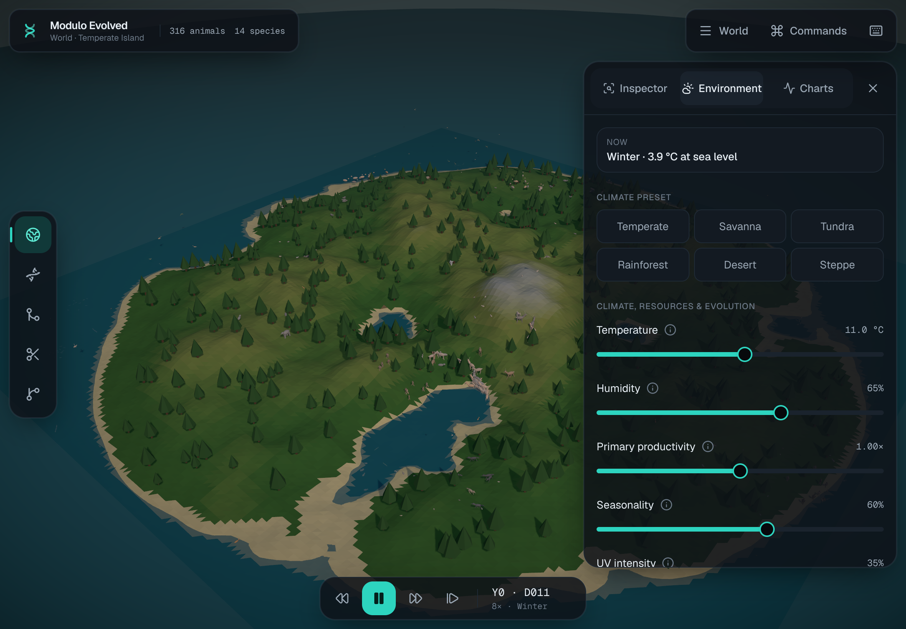
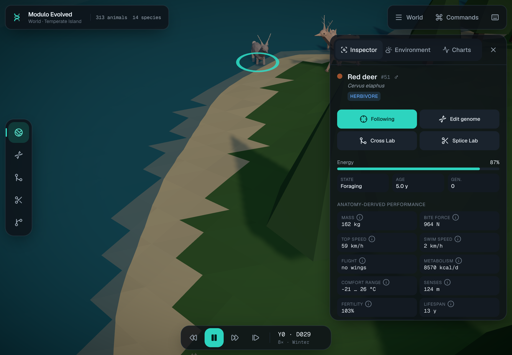
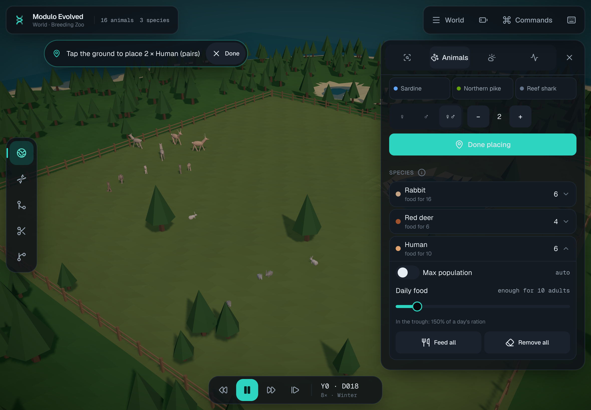

# Modulo Evolved

**A scientific 3D evolution simulator and genetics sandbox, built for iPad.**

Eighteen real species, humans among them, live on a procedurally generated island. Each animal carries a diploid genome of 59 loci on a linkage map; its anatomy, physiology and behavior are expressed from that genome. Energy flows from a regrowing vegetation grid through herbivores to predators. Natural and sexual selection, drift, mutation and migration act on real alleles, and new species split off when populations diverge. You can pause at any time to edit genomes, run Punnett crosses, or splice body parts between species into chimeras whose physics honestly constrain what they can do.



<p>
  
  
</p>

## Features

- **World:** an instanced low-poly 3D ecosystem with about 600 simulated animals, running in a Web Worker.
  - Animals walk, swim, fly and hop on procedurally assembled bodies.
  - Season and climate are both simulated; there are four catastrophes: drought, ice age, meteor and plague.
- **Genetics:**
  - Diploid inheritance with dominance, epistasis (MC1R × TYRP1 gives 9:3:4), regulatory loci and recessive load.
  - MHC heterozygote advantage.
  - Recombination via Haldane's map function.
  - Sex determination: XY, ZW, or temperature-dependent (crocodile).
  - Mutations: point, indel, duplication and regulatory.
- **Ecology:**
  - Kleiber metabolism and Hirt running speeds.
  - Predation with stalking, vigilance, the confusion effect and optimal prey size.
  - Carrion, disease, territoriality, and heritable behavior.
- **Humans:** _Homo sapiens_ evolves under the same rules, with UV-driven pigmentation, lactase persistence, and culture as a second inheritance channel. An optional **Human impact layer** adds hunting, land clearing, farming and herding.
- **Speciation:** spatial demes with sustained F<sub>ST</sub> divergence. Daughter lineages appear live in the **Phylogeny** workspace.
- **Labs:**
  - **Genome Editor:** live phenotype preview, undo/redo.
  - **Cross Lab:** Punnett squares with linkage, and offspring distributions.
  - **Splice Lab:** transplant wings, limbs, tails, fins and more; parts become heritable genes, and anatomy-derived stats update instantly.
  - Any lab creature can be released into the world.
- **Charts:** population, biodiversity (Shannon H′), trait means and distributions, allele frequencies, heterozygosity, births/deaths/mutations, and climate.
- **Persistence:**
  - Autosave to IndexedDB, plus named saves.
  - `.modulo` file export and import.
  - Compressed share links for worlds and genomes.
- **Hands-on keeper tools** (the **Animals** panel, `B`):
  - Tap the ground to place animals of any species.
  - Feed one animal or all of them, and remove a species or clear the whole island.
  - Set a maximum population for any species.
  - Set daily rations such as "enough food for 10 humans".
  - Pick two animals and breed them on the spot.
  - Fast-forward 1, 5 or 10 generations.
- **Breeding Zoo:** a fenced paddock with a pond. The keeper feeds the animals, nobody gets eaten, and you decide who breeds. **Mini Island** is a small, battery-friendly world.
- **Low battery mode:** the battery button in the top bar.
  - Caps rendering at 30 fps at native resolution, with no shadows or effects.
  - Slows the simulation's ticks.
- **Scenarios:** Breeding Zoo, Mini Island, Temperate Island, African Savanna, Archipelago Speciation, Ice Age, Human Arrival (megafauna overkill), Hardy–Weinberg Lab and Founder Effect.



The science, the simplifications and the data sources are documented in [docs/SCIENCE.md](docs/SCIENCE.md).

## Controls

|                           | Touch                                 | Keyboard                                    |
| ------------------------- | ------------------------------------- | ------------------------------------------- |
| Orbit / pan / zoom        | 1-finger drag / 2-finger drag / pinch | Arrows / WASD / `=` `-`                     |
| Select / follow / menu    | Tap / double-tap / long-press         | `F` follows, `Esc` clears                   |
| Place / breed / feed      | Animals panel, inspector, long-press  | `B` opens the panel, `G` skips a generation |
| Play / pause, step, speed | Time dock                             | `Space`, `.`, `[` `]`                       |
| Workspaces                | Left rail                             | `1`–`5`                                     |
| Panels                    | Dock tabs                             | `I` `E` `C`, `\`                            |
| Undo / redo (editor)      | Toolbar                               | `⌘Z`, `⇧⌘Z`                                 |
| Save                      | World menu                            | `⌘S`                                        |
| Everything else           | Commands button                       | `⌘K`, `?` for all shortcuts                 |

Tip: in Safari on iPad, choose **Share → Add to Home Screen** for a fullscreen, app-like experience. The guided tour can be replayed from the World menu.

## Run locally

```bash
pnpm install
pnpm dev                      # http://localhost:3000
pnpm check                    # lint + typecheck + unit tests
pnpm build && pnpm test:e2e   # iPad smoke tests (Playwright)
```

Requires Node 22+ and pnpm 10.

### URL parameters

| Parameter       | Effect                                                                     |
| --------------- | -------------------------------------------------------------------------- |
| `?scenario=zoo` | Start a scenario (`zoo`, `mini`, `temperate`, `savanna`, `archipelago`, …) |
| `?seed=42`      | World seed (same seed and browser engine → same run)                       |
| `?agents=300`   | Agent budget (lower for older devices)                                     |
| `?nowelcome`    | Skip the welcome dialog (used by tests)                                    |
| `#m=…`          | Share payload (world settings or a genome), made by the app                |

`/dev/gallery` is an internal QA page showing every species and some chimeras side by side. In the browser console, `window.__modulo` exposes the world store, the UI store and the simulation client for debugging.

## Architecture

```
src/
  engine/       Pure TypeScript simulation core: no DOM, seeded RNG, unit-tested.
    genetics/   Genome layout, alleles, meiosis, mutation, expression, popgen, Punnett, splice.
    anatomy/    Phenotype → body plan and physics-derived stats.
    species/    Roster of 18 species, phylogeny (divergence times), founders.
    sim/        World: ecology, climate, vegetation, speciation, recorder, scenarios, save format.
  worker/       Simulation loop in a Web Worker: packed frames to the renderer, RPC for queries.
  sim/          Main-thread client and bridge: worker handle, world store, autosave, boot.
  render/       React Three Fiber scene: terrain, water, sky, instanced procedural creatures.
  features/     Workspaces and panels: shell, commands, inspector, labs, charts, phylogeny, world.
  persistence/  IndexedDB, gzip/deflate codecs, file import/export, share links.
  ui/           Design-system primitives (shadcn-style on Radix).
  state/        Zustand stores for UI, environment, labs and settings.
```

- **Stack:** Next.js (App Router), strict TypeScript, Tailwind CSS v4, Radix/shadcn-style components, Zustand, React Three Fiber + drei, Vitest, Playwright.
- **Performance:**
  - The simulation runs in a worker with a fixed time budget per tick and a spatial hash for neighbor queries.
  - The renderer draws every creature part type with a single instanced mesh, adds LOD, and lowers its quality automatically when the frame rate drops.
  - Settings offer "high" (shadows, bloom), "auto" and "battery" quality.
- **Determinism:** the engine never calls `Math.random`; every random draw comes from an explicit seeded `Rng`. Saves round-trip exactly.
- **Commands:** one registry (`src/features/commands/commands.ts`) feeds hotkeys, the command palette and the shortcut sheet.
- **Design tokens:** live in `src/app/globals.css` (`@theme`). Components use only token colors.

## Deployment

1. On [vercel.com/new](https://vercel.com/new), import this GitHub repository. The defaults (Next.js, `pnpm build`) work with no environment variables.
2. After that, every push to `main` deploys to production, and every pull request gets a preview URL.

CI (GitHub Actions) runs lint, format, typecheck, unit tests and build, followed by Playwright iPad smoke tests.

## License

MIT
