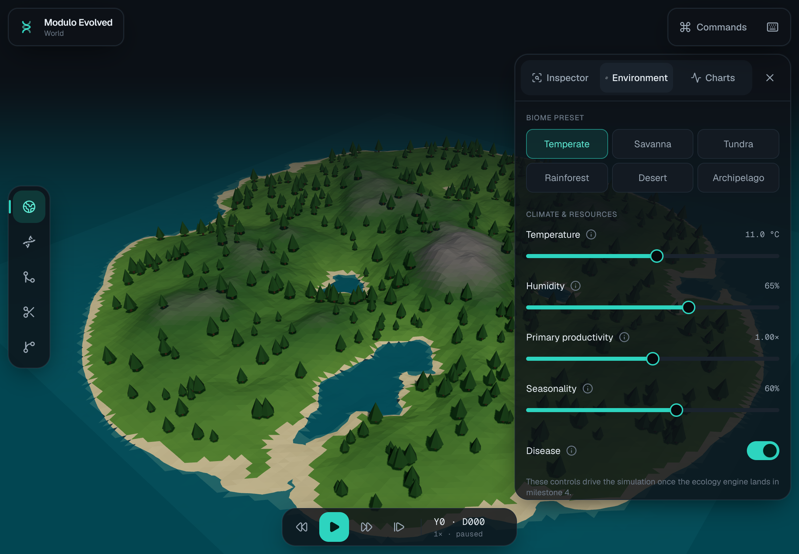
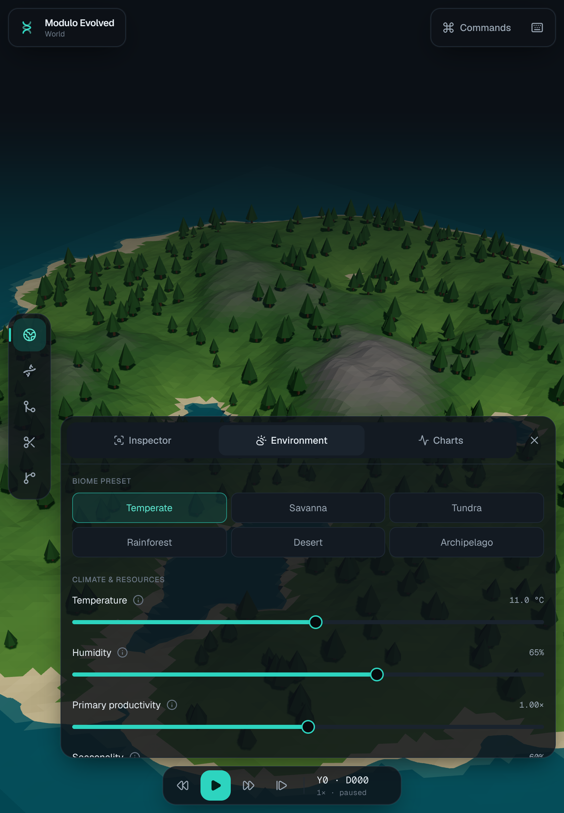
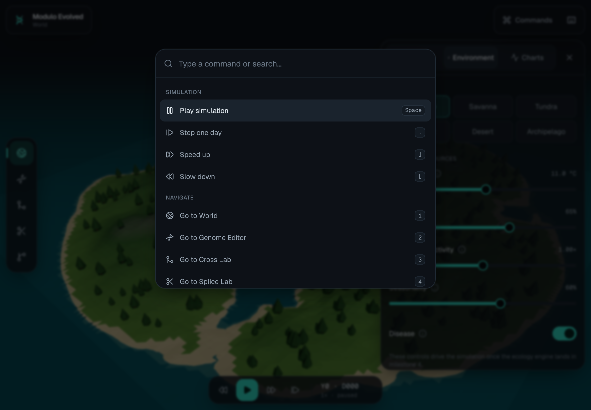

# Modulo Evolved

**A scientific 3D evolution simulator and genetics sandbox, built for iPad.**

Diploid genomes with linkage, epistasis and mutation. Real ecology with energy flow and trophic levels. Speciation you can watch happen. Chimeras whose anatomy has real trade-offs. Touch-first, with full keyboard control.



<p>
  
  
</p>

> **Status:** milestone 1 of 8 (scaffold and design system). See [docs/PLAN.md](docs/PLAN.md) for the roadmap.

## Controls

|                           | Touch                                 | Keyboard                    |
| ------------------------- | ------------------------------------- | --------------------------- |
| Orbit / pan / zoom        | 1-finger drag / 2-finger drag / pinch | Arrows / WASD / `=` `-`     |
| Play / pause, step, speed | Time dock                             | `Space`, `.`, `[` `]`       |
| Workspaces                | Left rail                             | `1`–`5`                     |
| Panels                    | Dock tabs                             | `I` `E` `C`, `\`            |
| Everything else           | Commands button                       | `⌘K`, `?` for all shortcuts |

Tip: in Safari on iPad, choose **Share → Add to Home Screen** for a fullscreen, app-like experience.

## Run locally

```bash
pnpm install
pnpm dev            # http://localhost:3000
pnpm check          # lint + typecheck + unit tests
pnpm build && pnpm test:e2e   # iPad smoke tests (Playwright)
```

Requires Node 22+ and pnpm 10.

## Architecture

```
src/
  engine/      Pure TypeScript simulation core. No DOM, deterministic seeded RNG, unit-tested.
  worker/      Simulation runs in a Web Worker; posts packed snapshots to the renderer (M3).
  render/      React Three Fiber scene: terrain, water, instanced procedural creatures.
  features/    App workspaces: shell, commands, editor, cross-lab, splice-lab, charts, phylogeny.
  ui/          Design-system primitives (shadcn-style on Radix): Button, Tabs, Slider, InfoTip…
  state/       Zustand stores for UI state. The worker owns simulation state.
```

- **Stack:** Next.js (App Router), strict TypeScript, Tailwind CSS v4, Radix/shadcn-style components, Zustand, React Three Fiber + drei, Vitest, Playwright.
- **Design tokens:** live in `src/app/globals.css` (`@theme`). Components use only token colors.
- **Commands:** one registry (`src/features/commands/commands.ts`) feeds hotkeys, the command palette and the shortcut sheet, so they never drift apart.
- **Determinism:** the engine never calls `Math.random`; every random draw comes from an explicit seeded `Rng`.

## Deployment

Deployed on Vercel via the Git integration: every push to `main` deploys production, and every PR gets a preview URL. CI (GitHub Actions) runs lint, format, typecheck, unit tests, build, and WebKit iPad smoke tests.

## License

MIT
